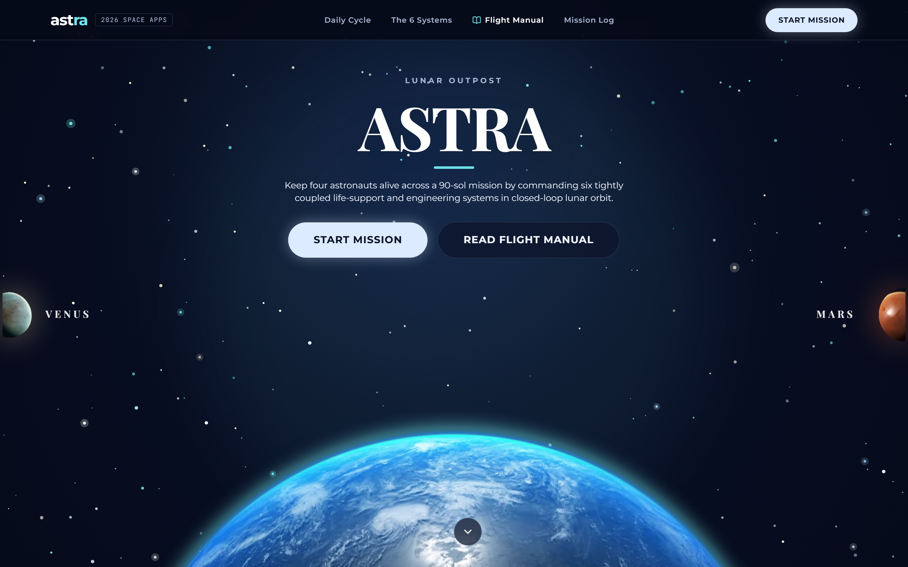
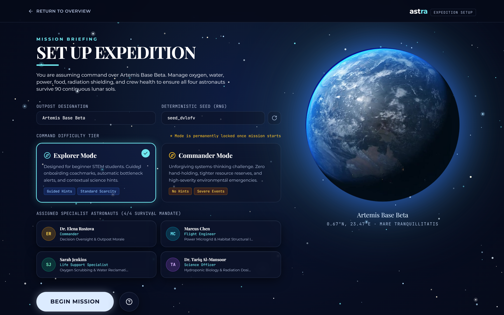
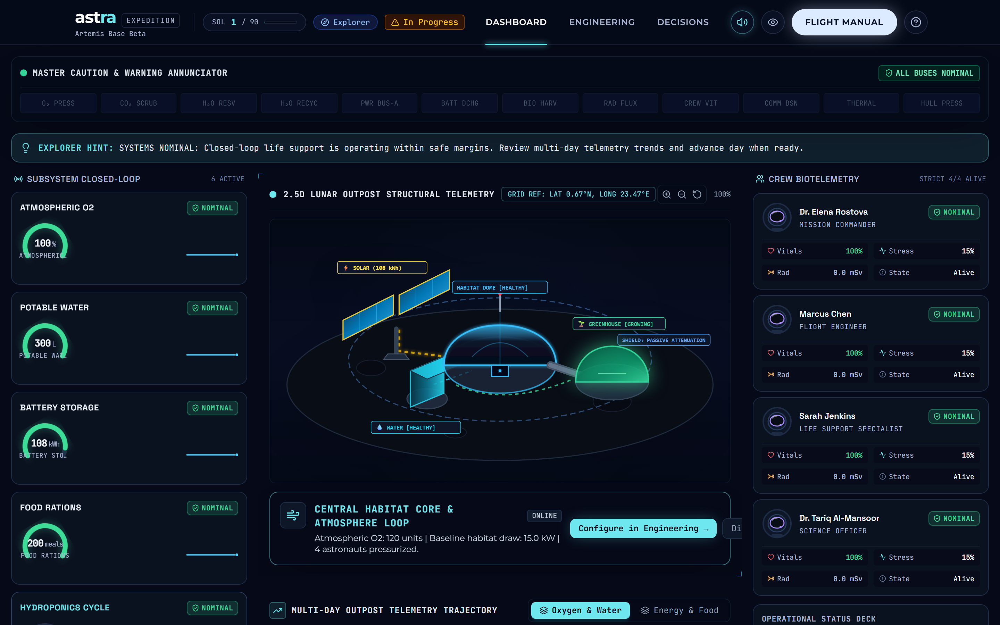
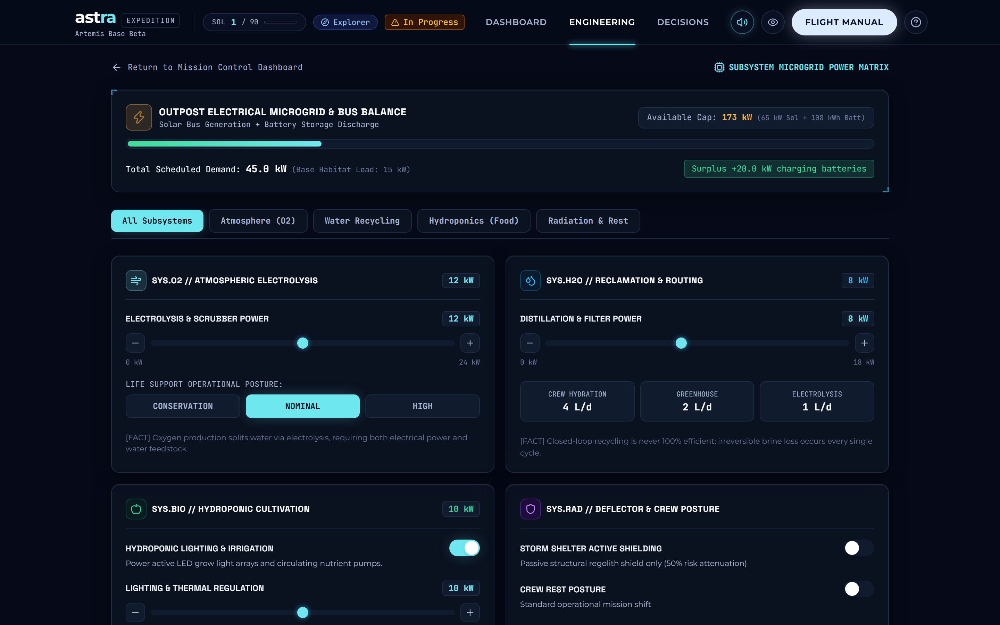
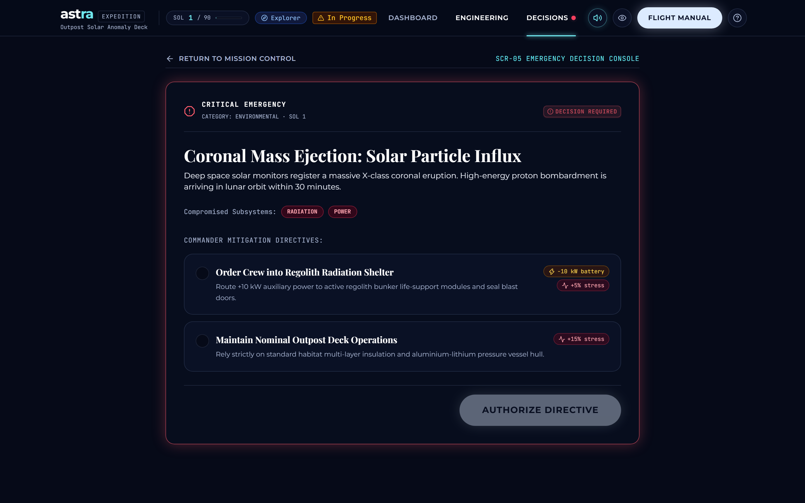
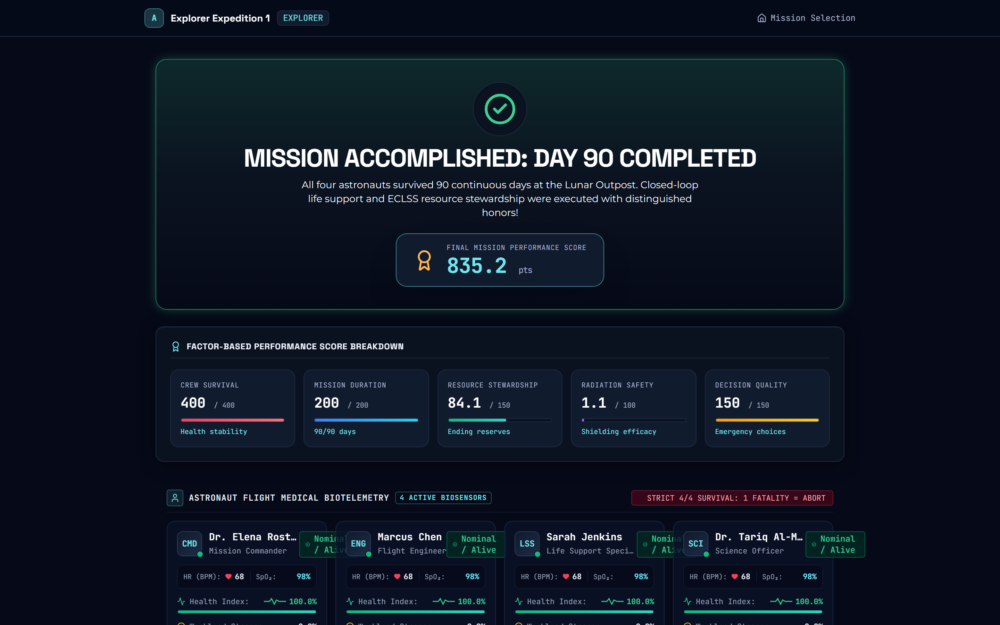

# ASTRA FLIGHT CREW MANUAL
### Junior Astronaut & Educator Guide to Closed-Loop Lunar Operations
**Project:** ASTRA – 2026 NASA Space Apps Challenge  
**Target Audience:** Students (Ages 12–18), Teachers, and STEM Explorers  

---

> [!IMPORTANT]
> **NASA NON-ENDORSEMENT NOTICE**  
> ASTRA is an independent educational simulation web application created for the 2026 NASA Space Apps Challenge. It is **not** affiliated with, endorsed by, sponsored by, or certified by NASA. Gameplay balance numbers, operational thresholds, and simulation rates are simplified educational models, not flight-certified aerospace telemetry.

---

## 1. THREE-STEP MISSION QUICKSTART

Welcome to the command deck of the Artemis Base Beta lunar outpost! Your goal is to guide four astronauts safely through a 90-sol expedition on the Moon.

```
┌─────────────────────────┐     ┌─────────────────────────┐     ┌─────────────────────────┐
│       STEP 1            │     │       STEP 2            │     │       STEP 3            │
│  Choose Your Difficulty │ ──> │   Scan The Six Gauges   │ ──> │  Allocate & Advance Sol │
│   Explorer or Commander │     │  O2, H2O, Power, Food   │     │ Resolve Critical Events │
└─────────────────────────┘     └─────────────────────────┘     └─────────────────────────┘
```

1. **Step 1: Choose Your Difficulty Mode**
   - **Explorer Mode (Recommended for your first mission):** Enjoy contextual AI flight controller hints, automatic recommendations, and expanded educational STEM takeaways whenever bottlenecks arise.
   - **Commander Mode (For advanced pilots):** Hints are stripped away. You operate with realistic margins, higher stress penalties, and stricter solar array conditions. Once locked at launch, the mode cannot be altered!

2. **Step 2: Read Your Closed-Loop Telemetry**
   - Check the 6 primary systems on your left rail and master annunciator panel.
   - Status indicators use triple-encoding: an icon, a descriptive label, and a color (`NOMINAL` in green, `CAUTION` in amber, `CRITICAL` in crimson).

3. **Step 3: Direct Engineering & Advance the Mission**
   - If a subsystem is dropping, click it or open **Engineering** (`SCR-04`) to rebalance your electrical microgrid bus and water supply.
   - If an emergency solar storm or equipment anomaly strikes, resolve it on the **Events Deck** (`SCR-05`).
   - Click **Advance to Day N+1** to step the lunar day-night cycle forward.

---

## 2. SCREEN-BY-SCREEN OPERATIONAL WALKTHROUGH

### SCR-01: Landing & Celestial Overview
The expedition portal greets you with an overview of your celestial destination: the Moon rising over a deep navy starfield with real-time pointer parallax.



- **Eyebrow & Serif Title:** Classical mission typography highlighting your destination and expedition tier.
- **Start Mission Pill:** Click the glowing pale pill button (`START MISSION`) to open expedition setup.
- **5-Step Daily Cycle Strip:** Summarizes the mission rhythm: Sun Angle Check ➔ Subsystem Consumption ➔ Engineering Rebalance ➔ Anomaly Resolution ➔ Telemetry Log.
- **The Six Critical Outpost Loops:** Educational introductory breakdown of each closed-loop system.
- **Saved Expeditions:** Automatically lists existing missions stored in your local session. Click **Resume** to jump right back into an active mission, or **View Report** to review debriefs.

---

### SCR-02: Expedition Setup & Briefing
The setup deck transitions into a detail state where the procedural Moon faux-sphere travels to the right, revealing the expedition briefing and crew dossier.



- **Mode Comparison Cards:** Toggle between **Explorer** (guided flight envelope) and **Commander** (unassisted mastery).
- **Crew Roster:** Review the four specialists under your care:
  1. *Dr. Elena Rostova* – Mission Commander (Geologist)
  2. *Marcus Chen* – Systems & ECLSS Engineer
  3. *Dr. Amina Diallo* – Astrobiologist & Hydroponics Lead
  4. *Sofia Ramirez* – Flight Surgeon & Medical Officer
- **Mission Seed & Label:** Enter a custom expedition name or roll a random seed for reproducible, deterministic runs.
- **Begin Mission:** Confirms your parameters and initializes Sol 1 on the backend.

---

### SCR-03: Mission Control Dashboard
The main flight deck where you spend the majority of your expedition:



- **Top Navigation Bar:** Displays current Sol (`SOL 1 / 90`), progress gauge, mode pill, active alerts, and quick-access navigation to Engineering, Events, and Flight Manual.
- **Left Rail (Subsystems):** Live mini gauges, trend sparklines, and status badges for Oxygen, Water, Power, Food, Hydroponics, and Radiation.
- **Center Stage (2.5D Outpost):** An interactive isometric schematic of the habitat modules, solar tracking arrays, hydroponic biodome, and water reclaimers. Subsystems glow according to operational health. Below it, an expandable Recharts telemetry graph tracks 90-sol history.
- **Right Rail (Biotelemetry):** Individual health, stress, and cumulative radiation dosimetry cards for each astronaut.
- **Primary Control (Advance Sol):** Large, prominent action button at the bottom right. If an emergency anomaly is active, this button turns into a critical hazard alert that routes you directly to the Events deck.

---

### SCR-04: Engineering & Microgrid Allocation
Accessible via the top bar or clicking any subsystem tile. Here you manage the outpost's shared physical resources.



- **Electrical Microgrid Power Bus:** Displays total solar generation, battery buffer, and total allocated draw. Use sliders with +/- stepper buttons to route power between Life Support, Water Recycling, Hydroponic Greenhouse, and Active Radiation Shelter.
- **Power Budget Invariant:** Total subsystem draw cannot exceed generation plus current battery storage. The interface enforces this with real-time feedback.
- **Oxygen Subsystem Mode:** Toggle between `CONSERVATION` (minimal power and water feed), `NOMINAL` (standard stoichiometric balance), and `HIGH` (rapid tank repressurization).
- **Hydroponics & Shelter Switches:** Toggle the greenhouse grow lights or enter high-power radiation shelter posture.

---

### SCR-05: Events & Emergency Decisions
When space weather strikes or equipment degrades, the mission pauses and displays the emergency decision deck.



- **Severity Triple-Encoding:** Banner prominently displays severity (`CRITICAL`, `CAUTION`, `MINOR`) with bold icons and text badges.
- **Anomaly Description:** Explains the physical root cause (e.g. Coronal Mass Ejection, Solar Flare, Radiator Dust Deposition).
- **Decision Option Cards:** Review trade-offs between available responses. Each option details the exact power cost, water consumption, stress impact, and physical shielding effect.
- **Explorer Hints:** In Explorer Mode, an AI flight recommendation highlights the scientific principle behind each choice (e.g., lunar regolith attenuation properties).
- **Confirmation:** Selecting an option immediately resolves the event on the backend and unblocks day advancement.

---

### SCR-06: Mission Debriefing & Telemetry Report
When Day 90 is completed (or if an unrecoverable life-support failure terminates the mission early), the comprehensive debriefing report opens.



- **Outcome Banner:** Highlights mission completion or the physiological cause of early termination.
- **Five-Factor Performance Score:**
  - *Crew Survival (0–400 pts):* Health stability of all 4 astronauts.
  - *Mission Duration (0–200 pts):* Pro-rated sols survived.
  - *Resource Stewardship (0–150 pts):* Final ending reserves of oxygen, water, and power.
  - *Radiation Safety (0–100 pts):* Efficacy in shielding the crew from cumulative cosmic rays.
  - *Decision Quality (0–150 pts):* Optimal choices during emergency events.
  - *Commander Multiplier:* 1.25x bonus applied for unassisted Commander runs.
- **Full 90-Sol Telemetry Graph:** Multi-line chart showing complete resource trajectories from Sol 1 to Sol 90.
- **Curated STEM Takeaways:** Real-world closed-loop aerospace engineering principles drawn directly from your gameplay choices.

---

## 3. QUALITATIVE CLOSED-LOOP SYSTEMS GUIDE

ECLSS (Environmental Control and Life Support Systems) is governed by strict laws of physics. Understanding how these loops connect is the key to surviving 90 sols:

```
                           ┌──────────────────────────┐
                           │    SOLAR & BATTERIES     │
                           └─────────────┬────────────┘
                                         │ Power Bus (kW)
                    ┌────────────────────┼────────────────────┐
                    ▼                    ▼                    ▼
           ┌─────────────────┐  ┌─────────────────┐  ┌─────────────────┐
           │   ECLSS O2      │  │  WATER RECYCLE  │  │   HYDROPONICS   │
           │ (Electrolysis)  │  │ (Urine & Cond.) │  │   (Crop Growth) │
           └────────┬────────┘  └────────┬────────┘  └────────┬────────┘
                    │ Consumes H2O       │ Reclaims ~85-92%   │ Harvests Food
                    ▼                    ▼                    ▼
           ┌───────────────────────────────────────────────────────────┐
           │                     4 FLIGHT CREW                         │
           │   Consume O2, H2O, Food • Emit CO2 & Wastewater • Stress  │
           └───────────────────────────────────────────────────────────┘
```

1. **The Oxygen Loop (Electrolysis vs. Respiration):**
   - Four astronauts consume a baseline of oxygen every sol.
   - Oxygen is replenished by water electrolysis (`2 H2O ➔ 2 H2 + O2`). Generating more oxygen requires both electrical power and water feedstock.
   - If oxygen drops below 15.0%, crew vitals drop rapidly.

2. **The Water Loop (Imperfect Recycling & Irreversible Loss):**
   - Astronauts require clean potable drinking water daily.
   - Wastewater from perspiration, condensation, and hygiene is filtered through mechanical and catalytic recyclers.
   - **Crucial Rule:** Water recycling is never 100% efficient. Between 8% and 15% is irreversibly lost every cycle due to brine disposal and filter saturation. Water levels will gradually drop unless managed carefully!

3. **The Electrical Microgrid (Zero-Sum Bus):**
   - Solar panels generate energy during the lunar daylight. Batteries buffer power during shadowed periods and peak load.
   - You cannot allocate more power than generation + battery storage. If power runs at a deficit, non-critical systems shut down first, followed by life support.

4. **The Hydroponic Greenhouse (Growth Time Buffer):**
   - Crops require steady water irrigation and LED grow lighting.
   - Crops do not produce food immediately: they require 14–15 continuous sols of growth before yielding a harvest of fresh rations.
   - If power or water is cut midway through a growth cycle, crop health degrades.

5. **Radiation Hazards & Regolith Shielding:**
   - Space is permeated by Galactic Cosmic Rays (GCR) and episodic Solar Particle Events (SPE).
   - Moving into the regolith storm shelter absorbs over 80% of ionising radiation, but increases electrical load and crew psychological stress from confinement.

6. **Crew Health, Stress & Fatigue:**
   - High stress accelerates vitals decline. If resources remain low for multiple consecutive days, astronauts develop chronic physiological fatigue.
   - Assigning **Rest Posture** in Engineering lowers workload and allows astronauts to recover health and reduce stress.

---

## 4. KEYBOARD SHORTCUTS & ACCESSIBILITY

ASTRA is built to strict **WCAG 2.1 AA** accessibility standards:

| Key / Control | Action | Scope |
| :--- | :--- | :--- |
| `Tab` | Advance focus to next interactive element | Global |
| `Shift + Tab` | Move focus to previous element | Global |
| `Enter` / `Space` | Activate focused button, card, or toggle | Global |
| `Arrow Left / Right` | Adjust allocation sliders by 1 step | Engineering (`SCR-04`) |
| `Home / End` | Jump slider to minimum / maximum value | Engineering (`SCR-04`) |
| `Escape` | Close active modal, dialog, or flight manual | Global |
| **Reduce Effects** | Disables star drift, rotation, and motion blurs | Header Toggle |

> [!TIP]
> **Reduced Motion Support:** ASTRA automatically detects your operating system's `prefers-reduced-motion` setting and turns off procedural planetary spin, star drift, and heavy transitions. You can also toggle this at any time using the **Effects** switch in the top header.
